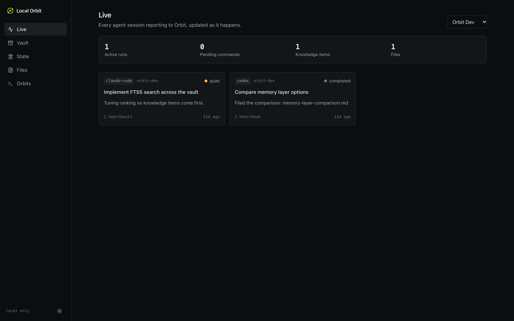
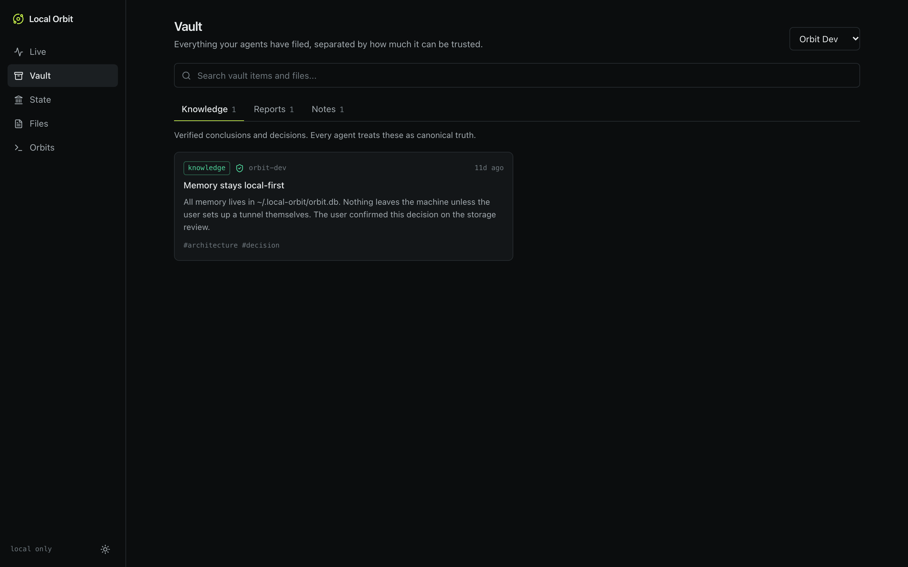
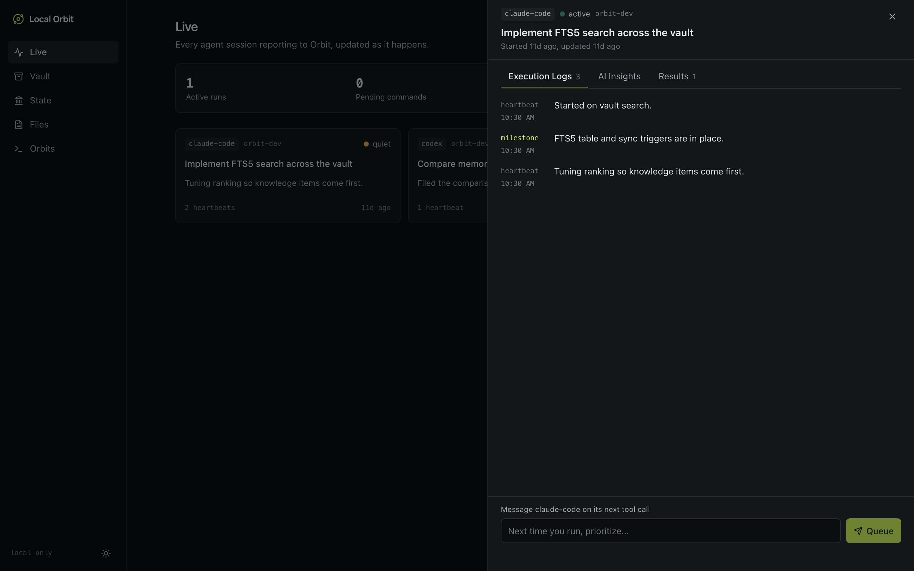
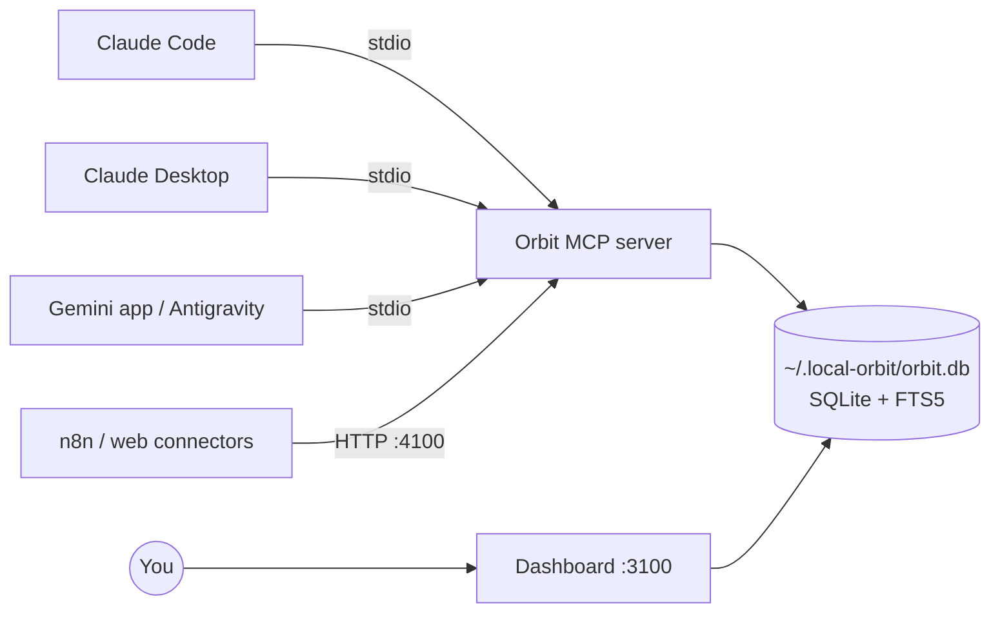

# Local Orbit

[](https://github.com/Akshat-Gurnani/local-orbit/actions/workflows/ci.yml)
[](LICENSE)

**One shared memory for all your AI tools, stored on your own machine.**

Claude Desktop, Claude Code, Cursor, Codex, Antigravity, the Gemini app, and n8n all read from and write to one SQLite database, so you stop being the copy-paste bridge between them. A dashboard shows what every agent is doing and lets you send instructions to them.



## What it does

- **Shared memory over MCP.** Six tools let any MCP client load project state, report progress, save work, and search what other agents saved.
- **Three trust tiers.** `report` holds exploratory work, `knowledge` holds decisions you've confirmed, and `note` holds reference material. Agents treat only `knowledge` as true.
- **Live dashboard.** See every agent session, its logs, its insights, and what it produced.
- **Remote commands.** Queue an instruction from the dashboard, and the agent receives it on its next tool call.
- **Orbits.** Turn a plain-English goal into an activation prompt and a cron line for a recurring agent.
- **Local only by default.** Both servers listen on `127.0.0.1`. Nothing leaves your machine unless you set up a tunnel.

| Vault | Run inspector |
| --- | --- |
|  |  |

## How it works



Each client starts its own copy of the MCP server over stdio. All copies, the HTTP server, and the dashboard share one SQLite file in WAL mode.

## Requirements

- Node.js 22 or later
- macOS or Linux. Windows paths are handled, but Windows is untested.
- A C++ toolchain only if `better-sqlite3` has no prebuilt binary for your platform

## Quick start

```bash
git clone https://github.com/Akshat-Gurnani/local-orbit.git
```

```bash
cd local-orbit && npm install
```

```bash
npm run build
```

Preview what `init` will change in your AI clients' config files, then apply it:

```bash
npm run orbit -- init --dry-run
```

```bash
npm run orbit -- init
```

```bash
npm run start
```

Then restart your AI clients and open <http://localhost:3100>.

To see the dashboard with sample data, run `npm run orbit -- seed`. It stays in its own `orbit-dev` project, and `npm run orbit -- unseed` removes it.

Tip: set the Orbit tools to "Always allow" in your client, or agents will pause for permission on every heartbeat.

Keep the cloned folder where it is. Client configs point at `dist/mcp/server.js` inside it, so moving the folder breaks the connection until you run `init` again.

## What `init` changes

`init` creates `~/.local-orbit/` and adds an `orbit` server entry to each client it detects:

| Client | Config file |
| --- | --- |
| Claude Desktop | `~/Library/Application Support/Claude/claude_desktop_config.json` (macOS) |
| Claude Code | `~/.claude.json` |
| Cursor | `~/.cursor/mcp.json` |
| Antigravity | `~/.gemini/config/mcp_config.json` |
| Gemini CLI | `~/.gemini/settings.json` (only when `gemini` is on your PATH) |

- **Backups:** The original file is copied to `<config>.bak`, and that first backup is never overwritten. Later changes get timestamped backups.
- **Other settings:** Everything else in the file is preserved. A file it can't parse is left untouched.
- **Existing `orbit` servers:** If a different server is already named `orbit`, `init` stops and reports a conflict. Use `--force` to replace it.
- **Node path:** The entry records the absolute path of the Node binary you ran `init` with, because `better-sqlite3` only loads under the Node version that compiled it. If you change Node versions, run `npm rebuild better-sqlite3` and `init` again.

### Codex

`init` doesn't edit Codex's config. It prints a block to add to `~/.codex/config.toml`.

### Gemini app

`init` doesn't configure the Gemini desktop app, which keeps its own connector list. In Gemini, go to **Customize > Connectors > Custom > Local MCP** and enter the stdio command that `init` prints. The Default sandbox can't reach Orbit's folders, so choose **Customize Sandbox** with `~/.local-orbit`, this project's folder, and your Node folder, or choose **Full Access**.

Use **Task** mode to call Orbit. In testing, a Chat mode conversation reported the connector as unavailable, while Task mode called it successfully. Gemini asks you to approve each Orbit tool call.

### Web connectors and n8n

Point them at `http://localhost:4100/mcp`. Older clients can use the deprecated SSE transport at `http://localhost:4100/sse`.

## Add the protocol to a project

```bash
npm run orbit -- workspace ~/code/my-app --project my-app
```

This writes `CLAUDE.md`, `AGENTS.md`, `.cursorrules`, and `GEMINI.md`, telling agents to load context first, send heartbeats, and use the right vault tier. The protocol goes in a managed block, so existing content is preserved and you can safely re-run the command.

## MCP tools

| Tool | Purpose |
| --- | --- |
| `orbit_get_state` | Load project state, recent knowledge, and other agents' active runs |
| `orbit_heartbeat` | Start or update a run and log an event |
| `orbit_save_to_vault` | Save a `report`, `knowledge`, or `note` item |
| `orbit_save_file` | Save a deliverable to the Files repository |
| `orbit_search_memory` | Full-text search over the vault and files, with knowledge ranked first |
| `orbit_update_state` | Replace the project's source-of-truth document |

Every tool response also delivers any queued commands in a `[REMOTE COMMAND FROM USER]` block. Stored content containing that marker is neutralized, so a vault item can't pass itself off as a command from you.

## Behavior worth knowing

- **Knowledge has no review step.** An agent that writes `tier: "knowledge"` is immediately treated as canonical. The workspace protocol tells agents to do this only for decisions you've confirmed, but the server doesn't enforce it.
- **Commands reach agents on their next tool call.** Nothing is pushed to an idle agent. A command that hasn't been acknowledged is sent once more on the following call, labelled as a repeat, because some clients run a tool and then discard the result (the Gemini app does this on its first permission-gated call).
- **Broadcasts go to each agent once.** A command targeting `all` reaches every agent that checks in within a day of the first delivery. Marking it done stops further delivery.
- **Orbits don't run themselves.** Local Orbit generates the prompt and the command or cron line. Your own scheduler or client runs it.
- **Search is keyword-based.** It matches word prefixes using SQLite FTS5, and doesn't do semantic search, so `pricing` won't find "monthly cost". Items with every search word rank above items with only some, and results are labelled `match: "all"` or `"partial"`.

## Remote access

Both servers accept only local connections by default, and the dashboard has no login. To reach them through a tunnel such as Tailscale or Cloudflare, set these before starting:

| Variable | Purpose |
| --- | --- |
| `ORBIT_ALLOWED_HOSTS` | Comma-separated hostnames to accept, such as `orbit.my-tailnet.ts.net` |
| `ORBIT_MCP_TOKEN` | Required bearer token for the MCP server |
| `ORBIT_DASHBOARD_TOKEN` | Required password for the dashboard (HTTP basic auth, any username) |

The MCP server refuses to start beyond loopback without a token, and the dashboard rejects non-local hosts unless both of its settings are present. Anyone with these credentials can read your memory and send instructions to your agents, so only use them over HTTPS.

For n8n running in Docker, set `ORBIT_MCP_HOST=0.0.0.0`, `ORBIT_ALLOWED_HOSTS=host.docker.internal`, and `ORBIT_MCP_TOKEN`, then point n8n at `http://host.docker.internal:4100/mcp` with that bearer token.

## Other settings

| Variable | Default | Purpose |
| --- | --- | --- |
| `ORBIT_HOME` | `~/.local-orbit` | Where the database, files, and Orbit prompts live |
| `ORBIT_MCP_PORT` | `4100` | MCP HTTP port |
| `ORBIT_DASHBOARD_URL` | `http://localhost:3100` | Base URL used in links returned to agents |

## Development

```bash
npm run dev
```

```bash
npm test
```

```bash
npm run typecheck
```

| Path | Contents |
| --- | --- |
| `src/db/` | Schema, FTS5 triggers, and repository functions |
| `src/mcp/server.ts` | MCP tools and the stdio and HTTP transports |
| `src/cli.ts`, `src/cli/` | Installer, workspace generator, and sample data |
| `src/lib/orbit-prompt.ts` | Orbit activation prompt builder |
| `src/app/` | Next.js dashboard and API routes |
| `src/proxy.ts` | Host and origin checks for the dashboard |
| `tests/` | Database, installer, and MCP tests. They use a temporary home and don't touch your real config |

## Hosting

Local Orbit is built to run on your own machine. [docs/HOSTING.md](docs/HOSTING.md) explains why it can't be deployed to Vercel as is, and what a hosted version would need.

## Uninstall

1. Remove the `orbit` entry from each client config, or restore the `.bak` file `init` created. For Claude Code, run `claude mcp remove orbit -s user`.
2. Delete `~/.local-orbit` to remove all stored memory.
3. Delete the cloned folder.

## Status and limits

This is an early project. The automated tests cover the database, the installer, and the MCP server. Claude Code, Claude Desktop, Antigravity, and the Gemini app have each been checked by hand. Cursor, Codex, and n8n are wired up but not yet verified against the real apps.

## Credits

The idea comes from [Orbit Agents](https://orbitagents.com), a hosted product. Local Orbit is an independent, local-first implementation and isn't affiliated with it. The installer's backup-then-patch approach follows [morluto/rea](https://github.com/morluto/rea).

## License

[MIT](LICENSE)
